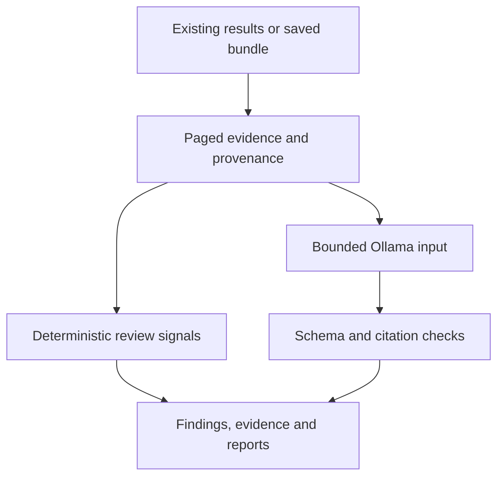

# Architecture

The GUI API, CLI and MCP tools call `services.investigations.InvestigationService`.
A plan is restricted to existing flows and hunts with zero launches. Bundle import uses
the same evidence, analysis and reporting code. The service also refuses persisted jobs
from unsupported collection modes before execution, resume, retry or report rebuilding.

Fixed VQL templates and validated identifiers are in `vql.py` and `ids.py`. The gRPC backend
uses bounded queries/deadlines and distinguishes server errors from empty successful results.
Flow retrieval keeps paging cursors and coverage; hunt retrieval reads flows with per-client
provenance. A model has no tools, cannot select queries, and sees delimited untrusted data.
Invalid citations are rejected. Valid row references do not prove a correct interpretation.

Evidence bundles carry versioned manifests, scoped evidence IDs and row hashes. Local
checkpoints permit retrieval to resume. Raw evidence, analysis requests and reports are
private local files. Reviews are append-only analyst metadata, separate from findings.
Explanations are optional interpretation; they do not change finding severity or evidence.

| Module | Responsibility |
|---|---|
| `velociraptor/` | Read API, flow normalization, metadata and query log handling |
| `evidence/` | Paged retrieval, bundle integrity, coverage, evidence browsing |
| `profiles/planner.py` | Existing-evidence scope plans; no collection planner |
| `analysis/` | Deterministic signals, bounded selection, Ollama, citation validation |
| `services/` | Shared pipeline, state, local reviews and explanations |
| `reporting/` | Canonical JSON and escaped Markdown/HTML |
| `cli.py`, `mcp_server.py`, `web/` | Adapters over shared services |

The bundled GUI has no runtime external assets. Inter, Vazirmatn and JetBrains Mono are served
locally, with separate body/code roles. Tests inject a synthetic backend and model from
`tests/support/`; production code never substitutes a fake backend or demo data.
